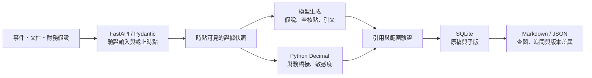

# 事件驅動交易假說研究系統

從事件、原始資料和財務假設建立可審閱的 Markdown 研究報告。每份原稿鎖定研究截止時點，保存多空假說、證據、待查點與可重算的財務橋接。研究員可以指定舊版追問，或只改批量建立情境子版。

[架構與驗證 PDF](docs/architecture.pdf) · [Astra Benchmark 報告 PDF](docs/astra-benchmark-report.pdf) · [初版評分紀錄](docs/astra-pilot-scorecard.json) · [實作計畫](plan.md)

## 架構與研究流程



- **證據時點**　文件的公開與取得時間皆須早於或等於研究截止時點。報告引用可追溯到文件與段落。
- **研究與計算**　模型提出因果機制、可驗證預測與推翻條件。Python 計算增量營收、營業利益、稅後盈餘及稀釋 EPS。缺少相符財務資料的事件維持定性研究。
- **版本保存**　SQLite 保存原始事件、證據快照與報告。新版報告分支重算時，沿用母版的定性假說與證據。相同事件內容與設定重送會回到既有原稿。

## 本機執行

使用 Python 3.11 以上。若專案所在磁碟不支援符號連結，可把虛擬環境建在支援符號連結的位置。

```bash
python -m venv .venv
source .venv/bin/activate
python -m pip install -r requirements.txt
python -m pytest -q
python -m research_app.demo
```

示範將原稿、情境子版、逐行差異及 SQLite 資料庫寫入 `output/demo/`。預設使用可重現的 `fixture` 模式。停工案以 600 批建稿，追問改成 300 批，單季 EPS 增量從 +0.048 元改為 −0.024 元，損益兩平量為 400 批。可用 `--output` 指定目錄。

## 瀏覽器工作台與 API

先用 `codex login status` 確認本機 Codex CLI 已透過 ChatGPT 登入，再啟動工作台。

```bash
RESEARCH_MODE=codex RESEARCH_CODEX_MODEL=gpt-6.2-astra \
  python -m uvicorn research_app.api:app --host 127.0.0.1 --port 8000
```

打開 `http://127.0.0.1:8000/`。左側案例與 10 題題庫使用 ASML 2024 Q3 財報、NVIDIA H20 申報及 Intel High-NA EUV 等真實歷史事件，附公司或 SEC 原始來源。採用公告日期的來源標示為歷史回放代理。選題後先確認建稿，再送出預填的追問。使用 Codex 模式時，模型透過本機 CLI 的現有登入執行。

工作台可送件、查證據、追問、切換版本與下載 Markdown。只有提供可重算財務輸入的報告才能重算批量。未設定 Codex 模式時，可預覽真實案例的公開證據。原始報告和版本保存在 SQLite。

互動式文件在 `http://127.0.0.1:8000/docs`。預設資料庫是 `output/research.sqlite3`，可用 `RESEARCH_DB` 指向既有 SQLite 檔案。以下命令在另一個終端執行。

```bash
result=$(curl -fsS http://127.0.0.1:8000/events \
  -H 'Content-Type: application/json' \
  --data-binary @research_app/fixtures/shutdown.json)
printf '%s\n' "$result"
report_id=$(printf '%s' "$result" | python -c 'import json,sys; print(json.load(sys.stdin)["report_id"])')
run_id=$(printf '%s' "$result" | python -c 'import json,sys; print(json.load(sys.stdin)["run_id"])')
curl -fsS "http://127.0.0.1:8000/runs/$run_id"
curl -fsS "http://127.0.0.1:8000/reports/$report_id/revisions/1"

curl -fsS "http://127.0.0.1:8000/reports/$report_id/questions" \
  -H 'Content-Type: application/json' \
  -d '{"parent_revision":1,"question":"客戶已認證乙嗎？"}'

curl -fsS "http://127.0.0.1:8000/reports/$report_id/questions" \
  -H 'Content-Type: application/json' \
  -d '{"parent_revision":1,"question":"若只能接到 300 批，乙還受益嗎？","overrides":{"lots":300}}'
```

分支回應包含 `child_revision`、逐項差異與帶符號的 EPS 差額。以該版本號呼叫報告 API 即可取得重算的報告。把範例的 `as_of` 改到 `2025-01-21T09:00:00+08:00` 並重新送件，可取得認證已公開且已收件的快照。第二個範例在 [demand.json](research_app/fixtures/demand.json)。

文件引用採 `文件 ID:段落 ID` 格式。報告僅納入公開及取得時間均不晚於截止時點的文件段落。財務模型使用單一幣別、整數批量及稀釋股數，金額與 EPS 以十進位字串回傳。可用 `research_target` 和 `research_horizon` 指定研究對象與期間，並排除不相符的財務參數。缺少可用財務參數時產生定性研究。重送相同事件內容及 adapter 設定會回傳同一原稿。找不到報告或版本時回傳 HTTP 404，輸入驗證失敗回傳 422，模型生成或引用驗證失敗回傳 502。

## 模型模式

`fixture` 使用本機規則生成可區分的情境與停工案的認證追問。研究其他事件時，可配置支援 JSON object 回應格式的 OpenAI 相容 Chat Completions 服務。先在執行環境設定 `RESEARCH_LLM_API_KEY` 及 `RESEARCH_LLM_MODEL`，視服務設定 `RESEARCH_LLM_BASE_URL`。模型服務會收到事件敘述與時點可見的研究快照，憑證與費用由執行者管理。

```bash
RESEARCH_MODE=live python -m uvicorn research_app.api:app --host 127.0.0.1 --port 8000
python -m research_app.demo --live --output output/live
```

模型提供結構化假說與引文回答。服務驗證引用是否存在於快照，財務計算由 Python 執行。引文是否實質支持模型解讀，仍屬研究員審核範圍。

### 使用本機 Codex CLI 驗證

電腦上若已有可執行的 `codex`，可用 `codex login status` 確認登入，再使用現有的 ChatGPT 登入執行驗證。

```bash
python -m research_app.demo --codex --output output/codex
```

程式從本機呼叫 Codex CLI，GPT 推論仍透過已登入的服務。命令用虛構停工案驗證多空假說、300 批重算、認證文件可見前後的回答，並用另一個需求下修案驗證定性研究。結果寫入 `output/codex/`，其中 `evidence-check.json` 記錄兩個時點的模型回答與引文。可用 `RESEARCH_CODEX_MODEL` 指定 CLI 支援的模型，或以 `RESEARCH_MODE=codex` 啟動 API，再送入其他事件。

報告審閱時，從摘要的主要變數與下一個查核點出發，沿引文確認原文支持到哪個客戶、產品與期間。多空假說各應提出可歸因於同一事件的機制及可辨識的觀察結果。情境財務表列出交付認列假設與稅盾，並分別顯示最低不虧損量和最低獲利量。以新版報告分支重算批量時，沿用母版的定性假說與證據快照。


## 驗證與 Astra 比較

### 自動搜尋與公開查核點

啟動 API 時設定 `RESEARCH_MODE=codex`。正常建稿時可自動搜尋發行人原始資料、補查發布時點或更正，再搜尋上游供應商、下游客戶、替代供應商與同業。供應鏈公司分析直接出現在第一份報告。每家公司列出產品範圍、來源支持的關係、事件傳導、財務重要性與公開查核點。

報告只納入原生搜尋工具回傳、符合指定網域與截止時點的 URL。公司名稱須出現在所引的可見來源。關係依證據分為已揭露產品關係、待確認的曝險對象和同業對照。找不到可靠公司或量化資料時，該欄列待查。模型整理的文字標為「來源摘要」。

每次建稿都會產出「延伸交易機會」，從供應鏈裡挑選收件時未點名的公司，最多四家。每筆列出財務傳導、公開催化劑、觸發與失效條件，以及交易前待查的資料。模型漏列時，系統以有來源的供應鏈關係補成觀察候選。只有具備已揭露產品關係的公司可以列條件式偏多或偏空，代號須有可見證據。缺乏合格候選時仍列出證據缺口。

報告 JSON 的 `assessment.trade_opportunities` 和 `assessment.trade_opportunities_gap` 保存這一區。追問和情境重算也會帶出對應版本的這兩個欄位。是否執行網路搜尋仍依送件或伺服器設定。

可為伺服器設定搜尋預設值。啟用後，使用者只需送事件與研究截止時點。

```bash
RESEARCH_MODE=codex RESEARCH_CODEX_MODEL=gpt-6.2-astra \
  RESEARCH_SEARCH_MODE=historical_replay RESEARCH_SEARCH_DOMAINS=asml.com,sec.gov \
  python -m uvicorn research_app.api:app --host 127.0.0.1 --port 8000
```

單筆送件也可指定 `search_mode` 和 `search_domains`。明確送 `"search_mode": "off"` 可關閉該筆搜尋。

```json
{
  "event_text": "ASML 公布 2024 Q3 財報。研究 2025 年接單與營收。",
  "research_target": "ASML",
  "research_horizon": "2025",
  "as_of": "2024-10-15T23:59:59Z",
  "search_mode": "historical_replay",
  "search_domains": ["asml.com", "sec.gov"]
}
```

預設為 `off`。`historical_replay` 依目前可見頁面上的公告日期，以 UTC 日末作為歷史可得時點代理。盤中時點和事後修訂的內容仍需歷史存檔核對。`live` 依實際取得時間過濾，截止點早於取得時間的補搜文件會排除。兩種模式均記錄搜尋輪數、工具操作數及納入的證據 ID。

```bash
python -m benchmarks.astra_pilot asml-harness --output output/astra-harness
```

### 追問補搜與證據子版

追問會帶入指定版本的供應鏈、延伸交易機會、公開查核點與假說。模型逐項對照問題要求，若回報某項尚未回答，系統只對欠缺的項目補答一次。原始事實仍以截止時點可見的證據為準。

事件可選填 `reported_calculations`，附上來自披露的兩個數值、單位和段落 ID。系統用 Decimal 計算占比、變化率或差額，排除時點不可見或單位不一致的輸入。追問選用計算時，答案會附原始數值、算式與來源；來源有約數時保留近似標記。[ASML 事件示例](research_app/examples/asml-q3.json)

已啟用搜尋的報告會先以指定版本回答追問。如果回答仍缺少直接證據，系統使用同一截止時點和來源網域補搜一輪。新證據必須通過時點與網址查核，且被第二次回答實際引用，才會保存為證據子版。回應包含 `child_revision`，可透過原本的報告版本端點重新讀取；子版的 `evidence_followups` 保存問題、回答、引用及搜尋紀錄。

```json
{
  "parent_revision": 1,
  "question": "ASML 2024 Q3 財報原本預定哪天公布？",
  "evidence_search": "auto"
}
```

搜尋沒有取得可引用的新證據時，回傳原回答與補搜狀態。可為單筆追問設定 `"evidence_search": "off"` 只查既有版本。歷史回放使用公告日期的可得時點代理；`live` 模式使用本次實際取得時間，因此截止點之後才收件的資料不會進入子版。

### Benchmark 摘要

四輪比較使用同一個 `gpt-6.2-astra`，以 ASML 2024 Q3 歷史回放和虛構停工案測試。

| 測試 | 純 Astra | 研究系統＋Astra | 觀察 |
|---|---:|---:|---|
| 初版事實與計算 | ASML 5/5、停工案 6/6 | ASML 5/5、停工案 6/6 | 純 Astra 網搜找到人工快照漏收的提前發布聲明 |
| 自動搜尋 | ASML 5/5（前輪基準） | ASML 5/5 | 從空白清單找到季報與提前發布聲明，補搜納入 Q2 財報 |
| 五題追問 | 15/15 | 15/15 | 純 Astra 補到原訂發布日；系統切開兩個證據時點，並保留母版與重算子版 |
| 供應鏈主動覆蓋 | 0/10 | 10/10 | 兩組只收到事件，評分題目事後才用來檢查首稿。系統主動分析四家公司 |

**結論。** 基礎題正確率打平。現有樣本支持 Harness 在主動供應鏈覆蓋、證據快照與版本重算的優勢。初版的 21 次既有版本重算中位數為 **3.78 毫秒**，全程沒有模型呼叫。追問遇到既有快照缺口時，純 Astra 的即時搜尋仍能補到更多資料。

評分涵蓋一個公開事件與一個虛構案例，以逐項核對完成，尚未做人工盲評。主動覆蓋分數只衡量供應鏈專項。各組耗時包含不同步驟，端到端延遲及成本尚無等預算比較。完整題目、計分口徑與時間邊界見 [Astra Benchmark 報告 PDF](docs/astra-benchmark-report.pdf)。

```bash
python -m benchmarks.astra_pilot asml-search --output output/astra-initial
python -m benchmarks.astra_pilot asml-snapshot --output output/astra-initial
python -m benchmarks.astra_pilot asml-system --output output/astra-initial
python -m benchmarks.astra_pilot synthetic-direct --output output/astra-initial
python -m benchmarks.astra_pilot synthetic-system --output output/astra-initial
```

### 公開題庫品質實驗

本機 Codex 以同一個 Astra、同一推理強度比較兩組。固定樣本包含 12 題 FinanceBench、8 題 FinSearchComp T3、5 題 FinanceGym 和 5 個真實供應鏈事件。FinanceBench 兩組讀相同原文節錄。其餘題組共用每題的搜尋網域及提示操作上限。供應鏈題只給事件，從首稿評分。

2026-11-23 完成 30 組配對、共 60 份回答。分數為本機匿名評審的每題平均，滿分 6 分。[完整報告 PDF](docs/public-benchmark-report.pdf) · [評分資料](docs/public-benchmark-scorecard.json)

| 題組 | 案數 | 純 Astra | Harness |
|---|---:|---:|---:|
| FinanceBench 財報節錄 | 12 | 5.75 | 5.75 |
| FinSearchComp T3 歷史搜尋 | 8 | 3.75 | 3.62 |
| FinanceGym 時點研究 | 5 | 4.00 | 4.80 |
| 供應鏈首稿 | 5 | 3.40 | 4.80 |

供應鏈首稿中，Harness 給出 12 個有來源且有催化劑和失效條件的交易假設，純 Astra 為 0。預先標註的公司關係則分別命中 6/13 與 9/13。18 個搜尋案中，Harness 有 16 案超過提示預算，純 Astra 皆在預算內。T3 的耗時中位數為 Harness 224.5 秒、純 Astra 51.3 秒。兩邊都在預算內的搜尋案共 2 案，等預算效果仍待更多樣本。

```bash
mkdir -p output/public-benchmark/inputs
curl -fL https://raw.githubusercontent.com/patronus-ai/financebench/main/data/financebench_open_source.jsonl -o output/public-benchmark/inputs/financebench.jsonl
curl -fL https://huggingface.co/datasets/ByteSeedXpert/FinSearchComp/resolve/1fd1beea75482e2dd5e2be8f618195d9c6aff176/finsearchcomp_data.json -o output/public-benchmark/inputs/finsearchcomp.json
curl -fL https://huggingface.co/datasets/Rujun/FinanceGym/resolve/main/benchmark_400_public.jsonl -o output/public-benchmark/inputs/financegym.jsonl
python -m benchmarks.public_pilot
python -m benchmarks.public_grade
```

輸出包含每一案原始回答、來源、Codex 工具事件、耗時與盲評分數，並匯出 `report.md`、`summary.json` 和 `questions-and-answers.md`。輸入檔雜湊與固定題號保存在 `manifest.json`。重跑會沿用完成的回答並重試失敗的執行。可用 `--case FB-01` 先跑單案。

FrontierFinance 下載需登入並接受資料存取條件，本輪以 FinanceBench 代替。FinanceGym 採非商用授權且完整 rubric 由主辦方保留。本機以匿名的 Sol 評審對任務完成、證據支持和推理各評 0 至 2 分。搜尋實耗另外稽核，時點回放使用目前搜尋索引。 [FrontierFinance](https://huggingface.co/datasets/samaya-ai/FrontierFinance/tree/main) · [FinanceBench](https://github.com/patronus-ai/financebench) · [FinSearchComp](https://randomtutu.github.io/FinSearchComp/) · [FinanceGym](https://financegym.github.io/)

### 假說風格 benchmark

比較傳統多空、財務傳導、競爭解釋、預期差、供應鏈外溢。六個真實事件在各自截止日凍結證據，每種方法使用同一個 Astra、相同欄位及一次呼叫，產出兩條假說。

評審用 Sol 在兩種匿名排序下檢查證據支持、因果傳導、預測可驗證性、失效條件及組內差異。每項 0 至 2 分。不存在的引用，以及兩次評分均確認有原文反證或事後資訊的候選，會被判為不合格。評分著重假說品質，預測實現率可另外用事前定義的結果追蹤。[評估方法參考](https://github.com/SKYLENAGE-AI/HypoArena#3-evaluation)

2026-11-23 首跑完成 30 組、60 條假說。傳統多空、財務傳導、預期差皆為 9.17/10，供應鏈外溢 8.67，競爭解釋 8.25。財務傳導的機制平均 2.00/2，預期差的可驗證預測平均 1.75/2，傳統多空的失效條件平均 1.92/2，各為本輪最高。供應鏈外溢的扣分多與產品級營運資料的公開可得性有關。這是六案、單一模型評審的探索性結果。

```bash
codex login status
python -m benchmarks.hypothesis_pilot
```

可加 `--case H-01` 先執行 ASML，或用 `--prepare-only` 檢查六份快照。完成後可在 `output/hypothesis-benchmark/` 查看 `report.md`、逐案原始假說及盲評、完整的 `hypotheses-and-reviews.md` 與 `summary.json`。

```bash
python -m benchmarks.hypothesis_pilot --compare-astra
```

這個模式新增簡短提示的純 Astra 及現行 Harness 報告流程。各組看同一份時點證據，停用搜尋，分數直接與純 Astra 配對。新執行的輸出目錄帶有正式提示版本，例如 `output/hypothesis-astra-v9/`，並保留 Harness 的完整原稿。

提示第 8 版的六案對照完成 84 條假說。純 Astra 平均 7.83/10，第 8 版 Harness 的假說欄位為 4.58，使用共用模板的傳統多空為 9.75。第 8 版 Harness 的證據支持為 2.00/2，但六案多空的組內差異平均為 0.00/2，多以同一項指標的互補門檻描述。拿掉組內差異後，純 Astra 為 5.83/8，Harness 為 4.58/8。這輪評分限於假說和引文，中位耗時分別為 22.78 秒與 67.62 秒。

#### 第 9 版與純 Astra 的對照

第 9 版要求多空各自提出不同的事件傳導，並交代公開查核來源、期間、基準、截止日及同口徑的反證。使用代理指標時須標明歸因限制。以 ASML 為例，新版多方查公開的 EUV 淨新增訂單，空方查毛利率指引下緣。

| 題組 | 案數 | 純 Astra／10 | 第 9 版 Harness／10 | Harness 勝／和／負 |
|---|---:|---:|---:|---:|
| 原本案例 | 6 | 8.17 | 9.83 | 5／1／0 |
| 新驗證案例 | 4 | 8.62 | 9.75 | 3／1／0 |
| 合計 | 10 | 8.35 | **9.80** | **8／2／0** |

新驗證案例是 UPS、Disney、Novo Nordisk 和 Ford。兩組用相同 Astra 與凍結證據，停用搜尋，由 Sol 交換匿名順序評分。純 Astra 生成假說的耗時中位數為 21.0 秒，Harness 生成完整原稿為 61.6 秒。分數衡量假說與引用品質。[驗證報告 PDF](docs/harness-v9-hypothesis-report.pdf) · [評分資料](docs/harness-v9-hypothesis-scorecard.json)

下列命令分別重跑兩組。完整原稿與逐案評分會寫入 `output/hypothesis-head-to-head-v9/` 和 `output/hypothesis-head-to-head-v9-holdout/`。

```bash
python -m benchmarks.hypothesis_pilot --head-to-head
python -m benchmarks.hypothesis_pilot --head-to-head --holdout
```

四案研究問題、封存引文、兩組原始回覆、兩次模型評分與本次重跑結果整理在 [V9 四案對照與覆核](/docs/v9-four-case-review/README.md)。另備 [分析師匿名 PDF](/docs/v9-four-case-review/analyst-review.pdf) 與 [評分表](/docs/v9-four-case-review/review-form.csv)。人工覆核者可先用匿名包評分，提交後再用公開問答核對。

#### V9 等呼叫與等時限的研究首稿評測

兩組保留原生成提示，共用 Astra medium、點時證據及 180 秒 CLI 上限，各一次啟動，停用搜尋。程式記錄 CLI 回報的實際詞元。先導完成 **1/4** 配對（Disney）。UPS 的純 Astra 逾時，Novo Nordisk 的 Harness 收到 HTTP 429 後依封存規則停止，Ford 保留為未啟動。八家新發行人的保留集已封存，先導門檻未通過，保留集尚未執行。

| 先導組別 | 啟動／完成 | 完成回覆中位耗時 | 可得輸入／輸出詞元 |
|---|---:|---:|---:|
| V9 Harness | 3／2 | 47.22 秒 | 35,576／3,279（2 回合） |
| 純 Astra | 3／2 | 29.84 秒 | 30,549／1,432（2 回合） |

正式人工盲評 **0 案**，目前可送評 1 個先導配對。人工可用率、重大錯誤數與本輪優劣待正式評分。新模型評分 **0 案**，前瞻實績 **0 案**。另附四個已封存的匿名校準案。評測程式已加入 CLI `stderr` 的限流停止偵測，正式批次與修正後的測試各保留紀錄。[完整報告](docs/v9-equal/report.pdf) · [逐案 QA](docs/v9-equal/QA.md) · [匿名覆核包](docs/v9-equal/analyst-review.pdf) · [空白評分表](docs/v9-equal/review-form.csv)

加入服務探針後，IBM 公告首試 **60.11 秒**通過，獨立記錄 **17,766／2,399** 輸入／輸出詞元。新批次沿用同一封存輸入，先導完成 **2/4** 配對（UPS、Disney）。Novo Nordisk 的純 Astra 收到 HTTP 429，CLI 宣告等待約 380 秒。程式在該次呼叫累計 3.82 秒時自動停派，三次呼叫保留為未啟動，八案保留集未執行。新人工盲評、模型評分及前瞻實績各 **0 案**，兩個正式配對可供分析師覆核。 [探針與正式批次報告](docs/v9-equal-probe/report.pdf) · [逐案 QA](docs/v9-equal-probe/QA.md) · [匿名包](docs/v9-equal-probe/analyst-review.pdf) · [空白評分表](docs/v9-equal-probe/review-form.csv)

```bash
python -m benchmarks.v9_equal --out output/v9-equal-new --phase seal
python -m benchmarks.v9_equal --out output/v9-equal-new --phase probe
python -m benchmarks.v9_equal --out output/v9-equal-new --phase pilot
python -m benchmarks.v9_equal --out output/v9-equal-new --phase holdout
python -m benchmarks.v9_equal --out output/v9-equal-new --phase judge
python -m benchmarks.v9_equal --out output/v9-equal-new --phase report
```

服務探針通過後才開先導。先導配對齊全時才開啟保留集，兩階段均齊全後才啟動雙順序模型評分。用同一輸出目錄可從一般程序中斷後接續尚未啟動的呼叫。遇到限流或模型容量錯誤的批次停止派發。收到人工評分後，`report` 可加 `--ratings` 匯入。匿名對照鍵留在本機輸出資料夾。 [上一輪預註冊與執行帳本](docs/v9-equal/README.md)

#### V9 限流後成對復原

四案沿用相同的點時證據、提示與 180 秒單次上限。暫時性失敗後依 CLI 公告冷卻，單次最多 900 秒。每案允許一次復原，兩組重跑並交換順序。首次完整配對率與固定復原預算內的配對率各自保留。匿名覆核只納入同一輪的完整配對。 [報告及完整帳本](docs/v9-equal-recovery/README.md)

正式批次首次完成 **2/4**（Disney、Ford），固定復原預算內完成 **4/4**，復原流程通過。UPS 和 Novo Nordisk 各收到一次 HTTP 429，分別冷卻 2 秒及 433 秒後反序重跑兩組。合計啟動 11 次、有效回覆 9 次，已回報 145,315／10,743 輸入／輸出詞元。四案均可送評，人工評分、新模型評分、保留集及前瞻實績各為 0 案。 [評測 PDF](docs/v9-equal-recovery/report.pdf) · [完整 QA](docs/v9-equal-recovery/QA.md) · [分析師匿名 PDF](docs/v9-equal-recovery/analyst-review.pdf) · [空白評分表](docs/v9-equal-recovery/review-form.csv)

```bash
python -m benchmarks.v9_equal_recovery --out output/v9-equal-recovery-new --phase seal
python -m benchmarks.v9_equal_recovery --out output/v9-equal-recovery-new --phase run
python -m benchmarks.v9_equal_recovery --out output/v9-equal-recovery-new --phase report
```

### 盈利預測、估值與研究員覆核

工作台的「ASML 盈利預測」案例提供兩季盈利、可獨立修改的情境、市場預期比較及年度本益比分析。案例重演 2024 Q3 公告當天。原始公告是實際資料，認列台數、單台收入、估值倍數與年度模型 EPS 是明列的回放假設。缺少歷史市場共識或當時股價時，報告會保留缺口。

[事件 JSON](research_app/examples/asml-earnings.json) 可直接送到 `POST /events`。其中 `earnings_plan` 鎖定事件時點、各類基準、當次披露及季度假設。款項用原幣，毛利率用小數比例，季度 EPS 以稀釋股數重算。事件前基準及其證據必須在事件前可取得。預期差只比較同指標、期別、分部、會計口徑與幣別，取各類最近一版。

可提供研究員填寫的空方、基準、多方假設，也可令 `generate_drivers` 為 `true` 並傳空的 `drivers`，讓 Astra 在已凍結的資料內草擬。程式把已符合收入認列條件的台數和單台收入分開計算。年度 P/E 先用同財年季度的稅後盈利差除以年度稀釋股數，再分解盈利與倍數影響。

| 操作 | API |
|---|---|
| 讀取預估、到期狀態與覆核紀錄 | `GET /reports/{id}/revisions/{v}/earnings` |
| 改假設並另存子版 | `POST /reports/{id}/earnings/branches` |
| 登記指標、區間、截止日及核對來源 | `POST /reports/{id}/revisions/{v}/forecasts` |
| 附實績披露核對 | `POST /reports/{id}/revisions/{v}/forecasts/{forecast_id}/resolve` |
| 記錄人工覆核決定 | `POST /reports/{id}/revisions/{v}/reviews` |

首次核對保留在原登記對應的版本。披露口徑有差異、缺值或晚於截止日會保留各自的狀態。已登記的二元區間機率可以計算 Brier score。歷史回放和正式登記分開標記。原稿及其預測區間不會被子版或覆核覆蓋。工作台的覆核人姓名由使用者填寫，供本機流程使用。

```bash
RESEARCH_MODE=codex RESEARCH_CODEX_MODEL=gpt-6.2-astra python -m benchmarks.earnings_demo
```

輸出包含 ASML 原稿、修改認列台數的子版、兩季實績核對及 SQLite，存於 `output/earnings-asml/`。研究員覆核可在報告的「盈利與覆核」頁面送出。實績另附同口徑披露原文。[ASML 工作流 PDF](docs/asml-earnings-workflow.pdf)

#### 30 案盈利回放與純 Astra

固定 AMD、Intel、Micron、Qualcomm 和 Texas Instruments 的 2019 至 2024 年 Q1 10-Q，共 30 案，對照未來兩季的合併營收、毛利率、營業利益與稀釋 EPS。模型看同一份事件與季節基準來源，使用同一個 Astra 及一個呼叫額度，停用搜尋。後續申報只交給計分。申報日期使用 UTC 日末作歷史可得代理。歷史回放仍可能受模型先驗知識影響。[SEC Company Facts 與申報 API](https://www.sec.gov/search-filings/edgar-application-programming-interfaces)

先將各公司的 SEC Company Facts JSON 下載到指定資料夾，以 `AMD.json`、`INTC.json`、`MU.json`、`QCOM.json`、`TXN.json` 命名。CIK 對照在 [資料建案程式](benchmarks/earnings_cases.py)。命令可加 `--case AMD-2019` 試跑一案。

```bash
python -m benchmarks.earnings_pilot --sec-dir output/earnings-benchmark/sec --output output/earnings-benchmark-v2
```

評分目錄包含逐案預測、實績引用、誤差、匿名覆核包 `blind-review.md` 和可填寫的 `review-form.csv`。實績與 A/B 方法對照另存。模型生成耗時和人工覆核耗時分開記錄。

本次完成 30 個事件、60 個未來季度。數字是平均絕對誤差。[評測報告 PDF](docs/earnings-benchmark-report.pdf) · [評分資料](docs/earnings-benchmark-scorecard.json)

| 指標 | 初版 Harness | 修正後 Harness | 純 Astra |
|---|---:|---:|---:|
| 營收（百萬美元） | 1170.99 | 613.86 | 507.94 |
| 毛利率（百分點） | 6.70 | 5.12 | 4.35 |
| 營業利益（百萬美元） | 1059.46 | 770.22 | 611.69 |
| 稀釋 EPS（美元） | 0.619 | 0.454 | 0.338 |

修正後四項誤差都下降。這次資料衡量歷史回放的合併財務數字，四項誤差仍由純 Astra 領先。修正後 Harness 的中位生成耗時為 32.8 秒，純 Astra 為 14.4 秒。人工盲評、覆核耗時與授權的歷史共識資料尚待接入。

### 假說與財務驅動的追溯

在工作台「盈利與覆核」頁面可新增跨季認列假說或匯入共識，兩者都另存子版。跨季認列需指定假說立場、原文、兩個期別、分部、台數、單價、公開查核及反證。引擎在兩季各減加同一筆營收，按各季口徑重算毛利、營業利益及 EPS，並檢查同一情境有無重複的台數調整。一般營收、毛利率和費用的影響也能個別連結。多項同時套用時，交互作用歸到後套用的項目。

把 `earnings_plan.generate_drivers` 設為 `true`，模型即可草擬多空數字的連結，並保留原假說與引文。模型連結會標作待覆核。來源與原假說無交集的連結，以及沒有明確配對的原始驅動調整，會另外列出。手動連結可在 `POST /reports/{id}/earnings/branches` 傳入 `driver_links`。

#### 點時市場共識匯入

`POST /reports/{id}/earnings/consensus` 接受母版號、標的、提供者、HTTPS 來源、快照擷取時間、用途及 CSV 內容。CSV 標題如下。

```text
metric,period_end,duration,scope,basis,currency,unit,low,high,available_at
```

金額可用 `currency` 或 `currency_millions`，EPS 用 `currency_per_share`，毛利率用 `fraction` 或 `percent`。供應商可得時間和快照時間須包含時區。程式保存匯入時點及內容雜湊，並要求快照早於事件。同一口徑的共識、指引及內部預估各自比較。請輸入有權使用的供應商匯出資料。本機範例沒有授權市場共識數值。

#### 等工作量與前瞻對照

```bash
python -m benchmarks.earnings_equal --driver-version 3 --sec-dir output/earnings-benchmark/sec
python -m benchmarks.earnings_prospective seed
python -m benchmarks.earnings_prospective run
python -m benchmarks.earnings_prospective status
```

歷史回放的三組均交兩季三情境及相同財務指標。純 Astra 與「Astra＋計算器」共用同一次原始回答，計算器重新對帳 EPS，Harness 用同一模型的一次呼叫草擬驅動。30 案、60 季的基準 EPS 平均絕對誤差分別為 0.356、0.438、0.451 美元。這批使用已知歷史案例。

前瞻隊列預先保留五家公司各六案，已封存 AMD、Intel、TI 三案的預測。其餘名額等待符合條件的新申報。下列命令可登記新的 SEC 原始申報，或在已封存的觀測季公開後補登實績。

```bash
python -m benchmarks.earnings_prospective enroll TICKER ACCESSION event.json
python -m benchmarks.earnings_prospective resolve CASE actual-quarter.json
```

實績檔含 `period_end`、`duration`、`scope`、`basis`、`currency`、`source`、`accession`、具時區的 `published_at`，以及 `revenue`、`gross_margin`、`operating_income`、`eps`。隊列要求同公司 SEC 來源，且實績發布時間晚於封存。SQLite 保留三組原始預測、封存時間及雜湊。匿名覆核表與解盲鍵分開保存。填寫 `review-form.csv` 後執行 `status`，可統計三組均完成的案例之重大錯誤率、可驗證率及人工覆核中位秒數。

#### 公司指引校準與 EPS 對帳

「盈利與覆核」可另存公司指引或 EPS 假設子版。EPS 可逐項設定稅率、稀釋股數、經常性營業外損益、一次性稅前營業外項目與所得稅費用。每項都附日期、計算依據及引文。虧損情境預設不認列稅務利益，可明列假設後啟用。API 可在 `earnings_plan.eps_assumptions` 或盈利子版傳入這些假設。

新生成的盈利研究自動採用可得且同季、同幣別、同會計口徑的合併公司指引。基準取營收與毛利率中點，其他情境以相同營收倍率與毛利率差額調整。分部按原情境比例分攤，明列的假說影響再另行套用。報告保留原草擬值與指引來源。手動子版可新增 `issuer_guidance` 並透過 `calibrate_guidance` 開關控制。

```bash
python -m benchmarks.earnings_calibration --run-model
python -m benchmarks.earnings_prospective --output output/earnings-calibration-prospective seed --guidance benchmarks/earnings_guidance_prospective.csv
python -m benchmarks.earnings_prospective --output output/earnings-calibration-prospective run
```

校準回放讀取上一節第 3 版的原始預測。若本機尚無資料，先執行上一節的歷史命令。同 30 案固定舊模型輸出，分開測試 EPS 對帳與公司指引。兩項套用後，Harness 的 EPS 平均絕對誤差由 0.451 降至 0.373 美元，毛利率由 5.176 降至 4.661 個百分點。另以本機 Astra 使用相同擴充後的點時資料重新生成 30 組配對。新 Harness 的毛利率誤差為 3.982 個百分點，純 Astra 為 4.250。EPS 誤差為 0.365 對 0.367 美元，營收誤差為 601.483 對 571.800 百萬美元。公司指引涵蓋下一季的 30 筆營收及其中 10 筆毛利率。公開指引的來源與時點記錄於 [歷史快照](benchmarks/earnings_guidance.csv)。

新方案已另行封存 AMD、Intel 和 TI 三案的預測，等待實績與研究員覆核。

#### 第二預測季營收橋接

對有兩個預測季的報告，可在「盈利與覆核」選「編輯第二預測季營收橋接」，或在事件的 `earnings_plan.revenue_bridge` 送入資料。每筆歷史營收附財年季度、原始來源與當時可得時間。可逐筆加上分部的量、價格、組合、認列或合併範圍調整。填寫調整時也須提供公開查核與反證。工作台顯示原草擬值、選用基準、各項調整、最後營收與可比的點時共識。已有第二預測季合併營收指引時，使用既有公司指引校準流程。

以 2019–2024 年的 30 案比較五種簡單基準，選出「第一預測季指引中點加歷史同季節轉換金額中位數」。另以較晚的八案與選模時未使用的三個 NVIDIA 案驗收。同一證據下，第二預測季營收 MAE 為純 Astra **39.74 億美元**、現版 Harness **40.84 億美元**、橋接版 **40.76 億美元**。橋接版比純 Astra 多約 2.6% 誤差，沒有達到低 5% 的門檻，故作為選用方案。三個各自搜尋的案例兩組均遵守兩次搜尋與兩次開頁上限。這三案的營收誤差也由 Astra 較低。

```bash
python -m benchmarks.earnings_horizon --run-model
python -m benchmarks.earnings_horizon_search
python -m benchmarks.earnings_prospective --output output/earnings-horizon-prospective --horizon seed --guidance benchmarks/earnings_guidance_prospective.csv
python -m benchmarks.earnings_prospective --output output/earnings-horizon-prospective run
```

驗收使用同一份 SEC Company Facts 資料夾，另需 `NVDA.json`。保留集的點時指引在 [歷史指引快照](benchmarks/earnings_guidance_horizon.csv)。`output/earnings-horizon/` 保存凍結的輸入、開發集診斷、各案橋接與匿名覆核表。兩位分析師填寫 `review-form.csv` 後，以不帶 `--run-model` 的驗收命令更新重大錯誤率、引文支持率、查核可行性與修稿時間。新版與既有隊列各自保存；新版已封存首批三案。

#### T+2 景氣轉折試驗

已有營收歷史的報告可在「盈利與覆核」選「套用 T+2 轉折偵測」。方法 `confirmed_turn` 比較公司指引與前幾年相同財季轉換的季節基準。指引偏離至少 12%，且當期實績偏離至少 8% 或同向公開營運資料提供支撐時，才調整原本的第二預測季營收與 EPS。自動調整以指引偏差金額的一半為基礎，上限為原營收預測的 15%。支援量、價、組合、產能及認列訊號，須填寫在研究截止前可見的來源。證據不足或互相衝突時，報告原稿營收、原因及下次查核項目。

```bash
python -m benchmarks.earnings_turns --run-model
```

12 案診斷表與引文輸出到 `output/earnings-turns/signals.csv`。另測 8 個不同申報事件，兩組使用相同資料。轉折規則在保留集觸發 0 案，漏掉 4 案上行，4 案正常季度均維持原估。這批保留集沒有下行結果，故下行表現只在診斷集與程式測例中可見。現版 Harness 的 T+2 營收平均絕對誤差為 20.85 億美元，低於純 Astra 的 22.26 億美元。轉折規則未改動任何保留集的營收數字，仍為選用功能。

#### T+2 預測修正 A／B

已有營收歷史的研究稿可在「盈利與覆核」建立「試算 T+2 修正 A」或「試算 T+2 修正 B」子版。A 以歷史季節轉換估計當期營收偏離，將可延續的部分與現版已反映的金額比較。B 可再加入 `revenue_bridge.residual_inputs` 中有當時來源、可量化且明確屬原預測未納入的分部增減項。相同原始文件、申報或經濟機制的重複項會被標記。第二預測季已有可比公司指引時，採用既有指引流程。報告顯示原預測、採用或撤回條件、調整金額，以及移除單項後的營收與 EPS。

```bash
python -m benchmarks.earnings_residual --run-model
python -m benchmarks.earnings_prospective --output output/earnings-residual-prospective --residual seed --from-cohort output/earnings-horizon-prospective
python -m benchmarks.earnings_prospective --output output/earnings-residual-prospective run
```

10 個不同申報事件以相同點時證據比較四組。各公司等權並按最後已公開營收標準化的 T+2 平均絕對誤差為純 Astra **11.490%**、現版 Harness **10.798%**、A／B **11.059%**。兩候選只調整一案並增加誤差，均未達歷史門檻。B 在這批案例沒有可確認的增量金額，11 個公開營運訊號留作研究查核。保留集來源及結果取值記錄在 [事件清冊](benchmarks/earnings_residual_cases.csv) 與 [營運來源清冊](benchmarks/earnings_residual_driver_ledger.csv)。

輸出在 `output/earnings-residual/`，含逐案的 `adjustments.csv`、候選與資料快照及雙人盲評表。四組前瞻隊列已分開封存 AMD、Intel、TI 三案，實績追蹤按期別計分。

#### 核對公告後的營收剩餘差額

在「盈利與覆核」打開指定季度的「核對新披露」。工作台讀取此版本已儲存的基準情境，接受 `original`（選填）和 `disclosure`。每筆需附 `key`、`available_at`、貨幣原始單位的 `low` 與 `high`，以及 `evidence_ids`。引文要在研究截止前可得，並明列同財季、合併範圍、會計基礎、幣別與公司營收指引區間。若現估落在已查核區間內，剩餘調整為零；區間外只試算至最接近的邊界；證據不足時暫緩。可試算案件會按現版毛利率、費用、稅務與股數假設列出營業利益和 EPS 的影響。這是只讀試算，報告版本由分析師另行管理。

```bash
python -m benchmarks.earnings_revision --run-model --out output/earnings-revision-rerun
```

以八個真實公告事件做點時回放。四案先導和四案發行人互斥的保留集均通過流程門檻。保留集主指標為新版 Harness 4/4、純 Astra 4/4、現版沿用封存預估 0/4，三組皆零誤調。保留集金額正確率由現版 2/4 提升至新版 4/4。兩組模型看相同的來源整理文本，各用本機 Codex 的 GPT-6.2 Astra medium 一次，停用搜尋，CLI 未另外限制詞元。比較以同口徑指引及差額為準，現版沿用凍結估值，並有明示的對照估值。嚴格領先純 Astra 的門檻未通過，發布後實績和分析師盲評仍待累積。

案例與原始公告連結保存在 [資料快照](benchmarks/earnings_revision_cases.json)；事先鎖定的規則、實際詞元、逐案模型回傳及判定保存在 `output/earnings-revision/`。

#### 用原始公告核對跨段財季與指引表格

原文跨段時，在「核對新披露」的 JSON 加入 `fiscal_label` 和 `disclosure.native_proof`。`fiscal_label` 是經覆核的公告財季名稱，可用原文的精確期末日期代替。`amount_ref` 和 `context_ref` 分別連至同一份公告的數值與財季原文，兩者均列入 `evidence_ids`。引用表格時，把原欄名與營收列依原本的順序保存成同一引文，以 `|` 分隔欄位，填入相同的 `amount_ref` 與 `header_ref`，並從第一個數值欄起以 `column: 0` 計。跨段核對目前用於已確認採美元、美國 GAAP 及合併口徑的發行人，支援公告中的百分比容許區間。此步驟使用報告已封存的原文摘錄。

```bash
python -m benchmarks.earnings_raw_revision --run-model --out output/earnings-raw-revision-rerun
```

在所有模型使用同一點時原文與凍結現估、各用一次本機 Codex 的 GPT-6.2 Astra medium 下，原文覆核的保留集全對數由現版 1/4 提升至新版 3/4，純 Astra 為 4/4。三組均零誤調。新版通過流程門檻。Hologic 的擷取確認了原文，驗證器漏認複數 `revenues`，嚴格領先門檻未通過。每案的原文、模型輸出、程式雜湊及個案審計保存在 `output/earnings-raw-revision/`。

#### 從完整公司公告覆核營收指引

在 Codex CLI 或模型 API 模式下，打開「盈利與覆核 → 從完整公告覆核」，上傳完整 HTML 並填入公告來源與點時資訊。系統依序保留公告正文和表格列，請模型標出當季新指引的位置，從所選原文核對並計算上下限與剩餘差額。財季映射可填公告使用的名稱。工作台會顯示可展開的原文、段落定位碼與原始公告連結。試算使用已封存的現估，適用於美元、美國 GAAP 的單季合併營收。

```bash
python -m benchmarks.earnings_full_revision --run-model --out output/earnings-full-revision-rerun
```

先導 5 案的全對數依序為現版 2/5、新版 4/5、純 Astra 5/5，通過先導門檻。四家未參與調整的保留發行人分別為 0/4、1/4、3/4，均零誤調，新版未達既定 3/4 的保留集門檻。保留集有兩案定位正確但驗證器因前次指引比較子句與多層表頭而暫緩。完整公告快照、規則、逐案模型回傳和匿名覆核包置於 `output/earnings-full-revision/`，公告清冊則在 [先導](benchmarks/earnings_full_pilot.json) 與 [保留](benchmarks/earnings_full_holdout.json) 資料檔。Hologic 納入回歸測試，未計入兩組案例。

#### 同句指引比較與多層表頭

完整公告驗證器先辨識完整的新指引，再處理後接的舊指引比較。單側門檻及只有舊數字的句子仍暫緩。表格保留 HTML 的合併跨欄、跨列及空欄，按數值的實際位置核對各層財季、會計口徑與初步或更新標記。工作台結果包含所選數值欄和原文連結。

```bash
python -m benchmarks.earnings_verifier --run-model --out output/earnings-verifier-rerun
```

重跑使用本機封存的公告 HTML 和上一版驗證器 `output/earnings-verifier/frozen/full_revision_before.py`。同一次 Astra 定位供新舊驗證器重播，另用一次同模型及同預算的純 Astra 回答。Ondas、SAIC 和 Hologic 僅作回歸。逐案的定位、驗證、金額及引文結果保存在 `output/earnings-verifier/`。

新版先導 3/4、現版 1/4、純 Astra 4/4。保留集新版及現版都是 1/4，純 Astra 4/4；新版有一筆 Progress 的金額單位誤讀。公告以左欄標示百萬美元，新版將區間誤當成美元，未通過零誤調和 75% 門檻。工作台提供原文試算供試驗覆核。評測報告保存封存版本、誤判原文與先導彙總錯誤的更正紀錄。

#### 完整公告的金額單位核對

營收差額以原文數字和已核對的幣別與倍率計算。倍率可來自金額本身、營收列標籤、同一表格的共用左欄、覆蓋選定數值欄的表頭或表格標題。工作台會列出原數、換算後美元區間和單位引文，並提供來源連結。遇到倍率或幣別缺失、矛盾或作用範圍不明時，結果暫緩並列明原因。

```bash
python -m benchmarks.earnings_units --run-model --out output/earnings-units-rerun
```

重跑使用 `output/earnings-units/` 的封存公告與上一版驗證器。兩版驗證器共用同一次 Astra 定位，純 Astra 在相同模型預算下獨立作答。Progress、Ondas、SAIC、Hologic 僅作回歸。預註冊、逐案原文、回傳、評分與匿名覆核包均隨本機輸出保存。

先導現版 2/4，新版與純 Astra 均 4/4，零誤調。保留集八次呼叫中四次逾時，另四次在主程序收到 SIGTERM 時未留下回覆，四案皆無可評結果。Progress 的封存定位回放已還原正確的 +5,985,000 美元差額。保留集執行未達回覆完整性門檻，樣本外比較仍待驗證。

#### 長公告評測與中斷續跑

`earnings_execution` 沿用封存的金額驗證器。先跑診斷量測，再依序封存、執行先導和保留集。保留集端點會重新核對先導門檻。新保留集的 SEC 公告原檔與可用時間保存在 `output/earnings-execution/filings/`，四案現估採用同份公告在截止時已公布的最近一季合併營收作為比較基準。

```bash
python -m benchmarks.earnings_execution --phase diagnose
python -m benchmarks.earnings_execution --phase seal
python -m benchmarks.earnings_execution --phase pilot
python -m benchmarks.earnings_execution --phase holdout
```

每次正式呼叫保存排隊、準備與開始時間，執行中寫入 CLI 事件與標準錯誤，結束後原子寫入逐次回傳。每批時限依工作數與並行度計算，四個工作槽處理八次呼叫的上限為 560 秒。收到中斷訊號時，開始過的呼叫保留為已占用額度。用同一目錄重執行該階段，可接續尚未啟動的工作。逐次時序匯總見 `execution.csv`。

## 專案結構

| 路徑 | 內容 |
|---|---|
| `research_app/api.py`、`schema.py` | FastAPI 端點與輸入、輸出契約 |
| `research_app/research.py`、`store.py` | 時點快照、財務計算、Markdown 報告與 SQLite 版本 |
| `research_app/earnings.py` | 盈利修正、估值分解與預測核對 |
| `research_app/adapters.py`、`demo.py` | 模型介接與可重跑的案例 |
| `research_app/fixtures/`、`tests/` | 虛構事件與回歸測試 |
| `research_app/examples/`、`web/` | 真實歷史事件及瀏覽器工作台 |
| `benchmarks/`、`docs/` | Astra 比較腳本、架構 PDF 與評分紀錄 |

本機執行產物寫入 `output/`。
