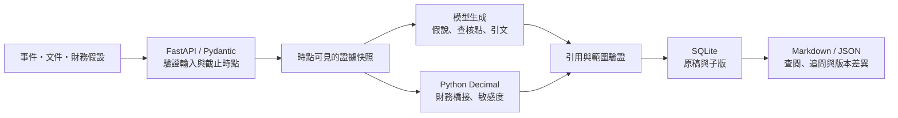

# 事件驅動交易假說研究系統

從事件、原始資料和財務假設建立可審閱的 Markdown 研究報告。每份原稿鎖定研究截止時點，保存多空假說、證據、待查點與可重算的財務橋接。研究員可以指定舊版追問，或只改批量建立情境子版。

[架構與驗證 PDF](docs/architecture.pdf) · [Astra 比較結果](docs/astra-pilot-scorecard.json) · [實作計畫](plan.md)

## 架構與研究流程



- **證據時點**　文件的公開與取得時間皆須早於或等於研究截止時點。報告引用可追溯到文件與段落。
- **研究與計算**　模型提出因果機制、可驗證預測與推翻條件。Python 計算增量營收、營業利益、稅後盈餘及稀釋 EPS。缺少相符財務資料的事件維持定性研究。
- **版本保存**　SQLite 保存原始事件、證據快照與報告。新版報告分支重算時，沿用母版的定性假說與證據。相同事件內容與設定重送會回到既有原稿。

## 本機執行

使用 Python 3.11 以上。若專案所在磁碟不支援符號連結，可把虛擬環境建在支援符號連結的位置。

```bash
python -m venv .venv
source .venv/bin/activate
python -m pip install -r requirements.txt
python -m pytest -q
python -m research_app.demo
```

示範將原稿、情境子版、逐行差異及 SQLite 資料庫寫入 `output/demo/`。預設使用可重現的 `fixture` 模式。停工案以 600 批建稿，追問改成 300 批，單季 EPS 增量從 +0.048 元改為 −0.024 元，損益兩平量為 400 批。可用 `--output` 指定目錄。

## API

```bash
python -m uvicorn research_app.api:app --host 127.0.0.1 --port 8000
```

互動式文件在 `http://127.0.0.1:8000/docs`。預設資料庫是 `output/research.sqlite3`，可用 `RESEARCH_DB` 指向既有 SQLite 檔案。以下命令在另一個終端執行。

```bash
result=$(curl -fsS http://127.0.0.1:8000/events \
  -H 'Content-Type: application/json' \
  --data-binary @research_app/fixtures/shutdown.json)
printf '%s\n' "$result"
report_id=$(printf '%s' "$result" | python -c 'import json,sys; print(json.load(sys.stdin)["report_id"])')
run_id=$(printf '%s' "$result" | python -c 'import json,sys; print(json.load(sys.stdin)["run_id"])')
curl -fsS "http://127.0.0.1:8000/runs/$run_id"
curl -fsS "http://127.0.0.1:8000/reports/$report_id/revisions/1"

curl -fsS "http://127.0.0.1:8000/reports/$report_id/questions" \
  -H 'Content-Type: application/json' \
  -d '{"parent_revision":1,"question":"客戶已認證乙嗎？"}'

curl -fsS "http://127.0.0.1:8000/reports/$report_id/questions" \
  -H 'Content-Type: application/json' \
  -d '{"parent_revision":1,"question":"若只能接到 300 批，乙還受益嗎？","overrides":{"lots":300}}'
```

分支回應包含 `child_revision`、逐項差異與帶符號的 EPS 差額。以該版本號呼叫報告 API 即可取得重算的報告。把範例的 `as_of` 改到 `2025-01-21T09:00:00+08:00` 並重新送件，可取得認證已公開且已收件的快照。第二個範例在 [demand.json](research_app/fixtures/demand.json)。

文件引用採 `文件 ID:段落 ID` 格式。報告僅納入公開及取得時間均不晚於截止時點的文件段落。財務模型使用單一幣別、整數批量及稀釋股數，金額與 EPS 以十進位字串回傳。可用 `research_target` 和 `research_horizon` 指定研究對象與期間，並排除不相符的財務參數。缺少可用財務參數時產生定性研究。重送相同事件內容及 adapter 設定會回傳同一原稿。找不到報告或版本時回傳 HTTP 404，輸入驗證失敗回傳 422，模型生成或引用驗證失敗回傳 502。

## 模型模式

`fixture` 使用本機規則生成可區分的情境與停工案的認證追問。研究其他事件時，可配置支援 JSON object 回應格式的 OpenAI 相容 Chat Completions 服務。先在執行環境設定 `RESEARCH_LLM_API_KEY` 及 `RESEARCH_LLM_MODEL`，視服務設定 `RESEARCH_LLM_BASE_URL`。模型服務會收到事件敘述與時點可見的研究快照，憑證與費用由執行者管理。

```bash
RESEARCH_MODE=live python -m uvicorn research_app.api:app --host 127.0.0.1 --port 8000
python -m research_app.demo --live --output output/live
```

模型提供結構化假說與引文回答。服務驗證引用是否存在於快照，財務計算由 Python 執行。引文是否實質支持模型解讀，仍屬研究員審核範圍。

### 使用本機 Codex CLI 驗證

電腦上若已有可執行的 `codex`，可用 `codex login status` 確認登入，再使用現有的 ChatGPT 登入執行驗證。

```bash
python -m research_app.demo --codex --output output/codex
```

程式從本機呼叫 Codex CLI，GPT 推論仍透過已登入的服務。命令用虛構停工案驗證多空假說、300 批重算、認證文件可見前後的回答，並用另一個需求下修案驗證定性研究。結果寫入 `output/codex/`，其中 `evidence-check.json` 記錄兩個時點的模型回答與引文。可用 `RESEARCH_CODEX_MODEL` 指定 CLI 支援的模型，或以 `RESEARCH_MODE=codex` 啟動 API，再送入其他事件。

報告審閱時，從摘要的主要變數與下一個查核點出發，沿引文確認原文支持到哪個客戶、產品與期間。多空假說各應提出可歸因於同一事件的機制及可辨識的觀察結果。情境財務表列出交付認列假設與稅盾，並分別顯示最低不虧損量和最低獲利量。以新版報告分支重算批量時，沿用母版的定性假說與證據快照。


## 驗證與 Astra 比較

本機測試通過 15 項 pytest。兩個虛構案例另經 GPT 審稿，六項品質面向均通過。停工案將認列量從 600 批改為 300 批，稀釋 EPS 增量由 +0.048 元降到 −0.024 元。400 批損益兩平，401 批起增量營業利益為正。

Astra 試跑在各組使用同一個 `gpt-6.2-astra`。ASML 2024 Q3 歷史回放的純網搜、同證據直接問答與系統組均答對 5 項。虛構案的直接問答與系統組均答對 6 項。網搜組另找到了公司提前發布聲明。系統在既有版本上做了 21 次本機重算，中位數 3.78 毫秒，並保存可重開的版本。

```bash
python -m benchmarks.astra_pilot asml-search --output output/astra-initial
python -m benchmarks.astra_pilot asml-snapshot --output output/astra-initial
python -m benchmarks.astra_pilot asml-system --output output/astra-initial
python -m benchmarks.astra_pilot synthetic-direct --output output/astra-initial
python -m benchmarks.astra_pilot synthetic-system --output output/astra-initial
```

比較包含一個公開事件與一個虛構案例。延遲是單次觀測，系統耗時未計人工整理證據。ASML 範例採附原始 URL 的中文摘要，報告目前沿用「原文」標籤。真實資料可得性、完整估值及研究員盲評仍待驗證。

## 專案結構

| 路徑 | 內容 |
|---|---|
| `research_app/api.py`、`schema.py` | FastAPI 端點與輸入、輸出契約 |
| `research_app/research.py`、`store.py` | 時點快照、財務計算、Markdown 報告與 SQLite 版本 |
| `research_app/adapters.py`、`demo.py` | 模型介接與可重跑的案例 |
| `research_app/fixtures/`、`tests/` | 虛構事件與回歸測試 |
| `benchmarks/`、`docs/` | Astra 比較腳本、架構 PDF 與評分紀錄 |

本機執行產物寫入 `output/`。
