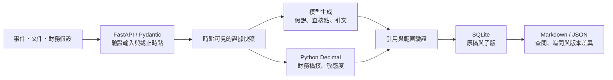

# 事件驅動交易假說研究系統

從事件、原始資料和財務假設建立可審閱的 Markdown 研究報告。每份原稿鎖定研究截止時點，保存多空假說、證據、待查點與可重算的財務橋接。研究員可以指定舊版追問，或只改批量建立情境子版。

[架構與驗證 PDF](docs/architecture.pdf) · [Astra Benchmark 報告 PDF](docs/astra-benchmark-report.pdf) · [初版評分紀錄](docs/astra-pilot-scorecard.json) · [實作計畫](plan.md)

## 架構與研究流程



- **證據時點**　文件的公開與取得時間皆須早於或等於研究截止時點。報告引用可追溯到文件與段落。
- **研究與計算**　模型提出因果機制、可驗證預測與推翻條件。Python 計算增量營收、營業利益、稅後盈餘及稀釋 EPS。缺少相符財務資料的事件維持定性研究。
- **版本保存**　SQLite 保存原始事件、證據快照與報告。新版報告分支重算時，沿用母版的定性假說與證據。相同事件內容與設定重送會回到既有原稿。

## 本機執行

使用 Python 3.11 以上。若專案所在磁碟不支援符號連結，可把虛擬環境建在支援符號連結的位置。

```bash
python -m venv .venv
source .venv/bin/activate
python -m pip install -r requirements.txt
python -m pytest -q
python -m research_app.demo
```

示範將原稿、情境子版、逐行差異及 SQLite 資料庫寫入 `output/demo/`。預設使用可重現的 `fixture` 模式。停工案以 600 批建稿，追問改成 300 批，單季 EPS 增量從 +0.048 元改為 −0.024 元，損益兩平量為 400 批。可用 `--output` 指定目錄。

## 瀏覽器工作台與 API

```bash
python -m uvicorn research_app.api:app --host 127.0.0.1 --port 8000
```

打開 `http://127.0.0.1:8000/` 使用研究工作台。離線模式會載入虛構停工示範，也能切到需求下修或供應鏈曝險案例。可送件、查證據、追問、重算批量、切換版本與下載 Markdown。工作台的開啟紀錄存在目前瀏覽器，原始報告與版本保存在 SQLite。

右上角的「試跑題庫」提供 10 題。選題會載入相應案例並填好追問或批量，確認後可送出。離線模式可演示認證與重算，開放式分析可用 Astra 模式試答。

需要執行 Codex 模型與網路搜尋時，可用既有的 Codex CLI 登入啟動。送件表單可指定搜尋方式和允許的來源網域。

```bash
RESEARCH_MODE=codex RESEARCH_CODEX_MODEL=gpt-6.2-astra \
  python -m uvicorn research_app.api:app --host 127.0.0.1 --port 8001
```

互動式文件在 `http://127.0.0.1:8000/docs`。預設資料庫是 `output/research.sqlite3`，可用 `RESEARCH_DB` 指向既有 SQLite 檔案。以下命令在另一個終端執行。

```bash
result=$(curl -fsS http://127.0.0.1:8000/events \
  -H 'Content-Type: application/json' \
  --data-binary @research_app/fixtures/shutdown.json)
printf '%s\n' "$result"
report_id=$(printf '%s' "$result" | python -c 'import json,sys; print(json.load(sys.stdin)["report_id"])')
run_id=$(printf '%s' "$result" | python -c 'import json,sys; print(json.load(sys.stdin)["run_id"])')
curl -fsS "http://127.0.0.1:8000/runs/$run_id"
curl -fsS "http://127.0.0.1:8000/reports/$report_id/revisions/1"

curl -fsS "http://127.0.0.1:8000/reports/$report_id/questions" \
  -H 'Content-Type: application/json' \
  -d '{"parent_revision":1,"question":"客戶已認證乙嗎？"}'

curl -fsS "http://127.0.0.1:8000/reports/$report_id/questions" \
  -H 'Content-Type: application/json' \
  -d '{"parent_revision":1,"question":"若只能接到 300 批，乙還受益嗎？","overrides":{"lots":300}}'
```

分支回應包含 `child_revision`、逐項差異與帶符號的 EPS 差額。以該版本號呼叫報告 API 即可取得重算的報告。把範例的 `as_of` 改到 `2025-01-21T09:00:00+08:00` 並重新送件，可取得認證已公開且已收件的快照。第二個範例在 [demand.json](research_app/fixtures/demand.json)。

文件引用採 `文件 ID:段落 ID` 格式。報告僅納入公開及取得時間均不晚於截止時點的文件段落。財務模型使用單一幣別、整數批量及稀釋股數，金額與 EPS 以十進位字串回傳。可用 `research_target` 和 `research_horizon` 指定研究對象與期間，並排除不相符的財務參數。缺少可用財務參數時產生定性研究。重送相同事件內容及 adapter 設定會回傳同一原稿。找不到報告或版本時回傳 HTTP 404，輸入驗證失敗回傳 422，模型生成或引用驗證失敗回傳 502。

## 模型模式

`fixture` 使用本機規則生成可區分的情境與停工案的認證追問。研究其他事件時，可配置支援 JSON object 回應格式的 OpenAI 相容 Chat Completions 服務。先在執行環境設定 `RESEARCH_LLM_API_KEY` 及 `RESEARCH_LLM_MODEL`，視服務設定 `RESEARCH_LLM_BASE_URL`。模型服務會收到事件敘述與時點可見的研究快照，憑證與費用由執行者管理。

```bash
RESEARCH_MODE=live python -m uvicorn research_app.api:app --host 127.0.0.1 --port 8000
python -m research_app.demo --live --output output/live
```

模型提供結構化假說與引文回答。服務驗證引用是否存在於快照，財務計算由 Python 執行。引文是否實質支持模型解讀，仍屬研究員審核範圍。

### 使用本機 Codex CLI 驗證

電腦上若已有可執行的 `codex`，可用 `codex login status` 確認登入，再使用現有的 ChatGPT 登入執行驗證。

```bash
python -m research_app.demo --codex --output output/codex
```

程式從本機呼叫 Codex CLI，GPT 推論仍透過已登入的服務。命令用虛構停工案驗證多空假說、300 批重算、認證文件可見前後的回答，並用另一個需求下修案驗證定性研究。結果寫入 `output/codex/`，其中 `evidence-check.json` 記錄兩個時點的模型回答與引文。可用 `RESEARCH_CODEX_MODEL` 指定 CLI 支援的模型，或以 `RESEARCH_MODE=codex` 啟動 API，再送入其他事件。

報告審閱時，從摘要的主要變數與下一個查核點出發，沿引文確認原文支持到哪個客戶、產品與期間。多空假說各應提出可歸因於同一事件的機制及可辨識的觀察結果。情境財務表列出交付認列假設與稅盾，並分別顯示最低不虧損量和最低獲利量。以新版報告分支重算批量時，沿用母版的定性假說與證據快照。


## 驗證與 Astra 比較

### 自動搜尋與公開查核點

啟動 API 時設定 `RESEARCH_MODE=codex`。正常建稿時可自動搜尋發行人原始資料、補查發布時點或更正，再搜尋上游供應商、下游客戶、替代供應商與同業。供應鏈公司分析直接出現在第一份報告。每家公司列出產品範圍、來源支持的關係、事件傳導、財務重要性與公開查核點。

報告只納入原生搜尋工具回傳、符合指定網域與截止時點的 URL。公司名稱須出現在所引的可見來源。關係依證據分為已揭露產品關係、待確認的曝險對象和同業對照。找不到可靠公司或量化資料時，該欄列待查。模型整理的文字標為「來源摘要」。

每次建稿都會產出「延伸交易機會」，從供應鏈裡挑選收件時未點名的公司，最多四家。每筆列出財務傳導、公開催化劑、觸發與失效條件，以及交易前待查的資料。模型漏列時，系統以有來源的供應鏈關係補成觀察候選。只有具備已揭露產品關係的公司可以列條件式偏多或偏空，代號須有可見證據。缺乏合格候選時仍列出證據缺口。

報告 JSON 的 `assessment.trade_opportunities` 和 `assessment.trade_opportunities_gap` 保存這一區。追問和情境重算也會帶出對應版本的這兩個欄位。是否執行網路搜尋仍依送件或伺服器設定。

可為伺服器設定搜尋預設值。啟用後，使用者只需送事件與研究截止時點。

```bash
RESEARCH_MODE=codex RESEARCH_CODEX_MODEL=gpt-6.2-astra \
  RESEARCH_SEARCH_MODE=historical_replay RESEARCH_SEARCH_DOMAINS=asml.com,sec.gov \
  python -m uvicorn research_app.api:app --host 127.0.0.1 --port 8000
```

單筆送件也可指定 `search_mode` 和 `search_domains`。明確送 `"search_mode": "off"` 可關閉該筆搜尋。

```json
{
  "event_text": "ASML 公布 2024 Q3 財報。研究 2025 年接單與營收。",
  "research_target": "ASML",
  "research_horizon": "2025",
  "as_of": "2024-10-15T23:59:59Z",
  "search_mode": "historical_replay",
  "search_domains": ["asml.com", "sec.gov"]
}
```

預設為 `off`。`historical_replay` 依目前可見頁面上的公告日期，以 UTC 日末作為歷史可得時點代理。盤中時點和事後修訂的內容仍需歷史存檔核對。`live` 依實際取得時間過濾，截止點早於取得時間的補搜文件會排除。兩種模式均記錄搜尋輪數、工具操作數及納入的證據 ID。

```bash
python -m benchmarks.astra_pilot asml-harness --output output/astra-harness
```

### 追問補搜與證據子版

已啟用搜尋的報告會先以指定版本回答追問。如果回答仍缺少直接證據，系統使用同一截止時點和來源網域補搜一輪。新證據必須通過時點與網址查核，且被第二次回答實際引用，才會保存為證據子版。回應包含 `child_revision`，可透過原本的報告版本端點重新讀取；子版的 `evidence_followups` 保存問題、回答、引用及搜尋紀錄。

```json
{
  "parent_revision": 1,
  "question": "ASML 2024 Q3 財報原本預定哪天公布？",
  "evidence_search": "auto"
}
```

搜尋沒有取得可引用的新證據時，回傳原回答與補搜狀態。可為單筆追問設定 `"evidence_search": "off"` 只查既有版本。歷史回放使用公告日期的可得時點代理；`live` 模式使用本次實際取得時間，因此截止點之後才收件的資料不會進入子版。

### Benchmark 摘要

四輪比較使用同一個 `gpt-6.2-astra`，以 ASML 2024 Q3 歷史回放和虛構停工案測試。

| 測試 | 純 Astra | 研究系統＋Astra | 觀察 |
|---|---:|---:|---|
| 初版事實與計算 | ASML 5/5、停工案 6/6 | ASML 5/5、停工案 6/6 | 純 Astra 網搜找到人工快照漏收的提前發布聲明 |
| 自動搜尋 | ASML 5/5（前輪基準） | ASML 5/5 | 從空白清單找到季報與提前發布聲明，補搜納入 Q2 財報 |
| 五題追問 | 15/15 | 15/15 | 純 Astra 補到原訂發布日；系統切開兩個證據時點，並保留母版與重算子版 |
| 供應鏈主動覆蓋 | 0/10 | 10/10 | 兩組只收到事件，評分題目事後才用來檢查首稿。系統主動分析四家公司 |

**結論。** 基礎題正確率打平。現有樣本支持 Harness 在主動供應鏈覆蓋、證據快照與版本重算的優勢。初版的 21 次既有版本重算中位數為 **3.78 毫秒**，全程沒有模型呼叫。追問遇到既有快照缺口時，純 Astra 的即時搜尋仍能補到更多資料。

評分涵蓋一個公開事件與一個虛構案例，以逐項核對完成，尚未做人工盲評。主動覆蓋分數只衡量供應鏈專項。各組耗時包含不同步驟，端到端延遲及成本尚無等預算比較。完整題目、計分口徑與時間邊界見 [Astra Benchmark 報告 PDF](docs/astra-benchmark-report.pdf)。

```bash
python -m benchmarks.astra_pilot asml-search --output output/astra-initial
python -m benchmarks.astra_pilot asml-snapshot --output output/astra-initial
python -m benchmarks.astra_pilot asml-system --output output/astra-initial
python -m benchmarks.astra_pilot synthetic-direct --output output/astra-initial
python -m benchmarks.astra_pilot synthetic-system --output output/astra-initial
```

## 專案結構

| 路徑 | 內容 |
|---|---|
| `research_app/api.py`、`schema.py` | FastAPI 端點與輸入、輸出契約 |
| `research_app/research.py`、`store.py` | 時點快照、財務計算、Markdown 報告與 SQLite 版本 |
| `research_app/adapters.py`、`demo.py` | 模型介接與可重跑的案例 |
| `research_app/fixtures/`、`tests/` | 虛構事件與回歸測試 |
| `benchmarks/`、`docs/` | Astra 比較腳本、架構 PDF 與評分紀錄 |

本機執行產物寫入 `output/`。
